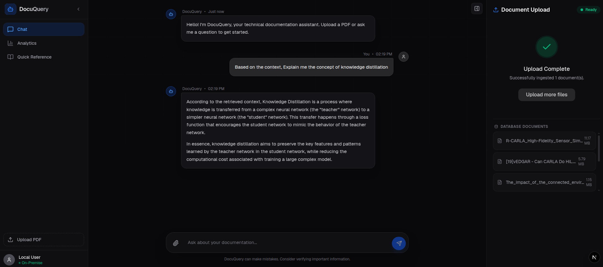
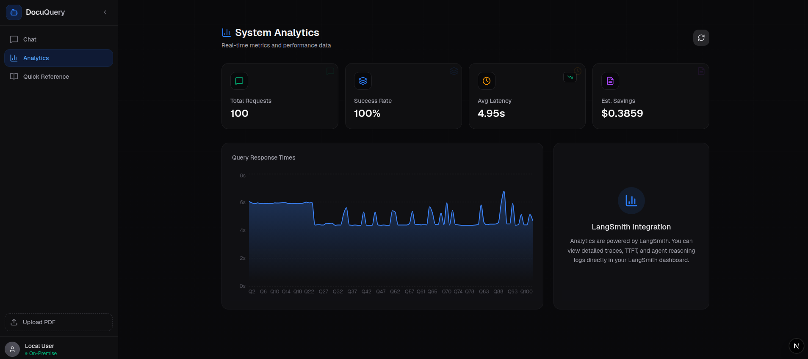
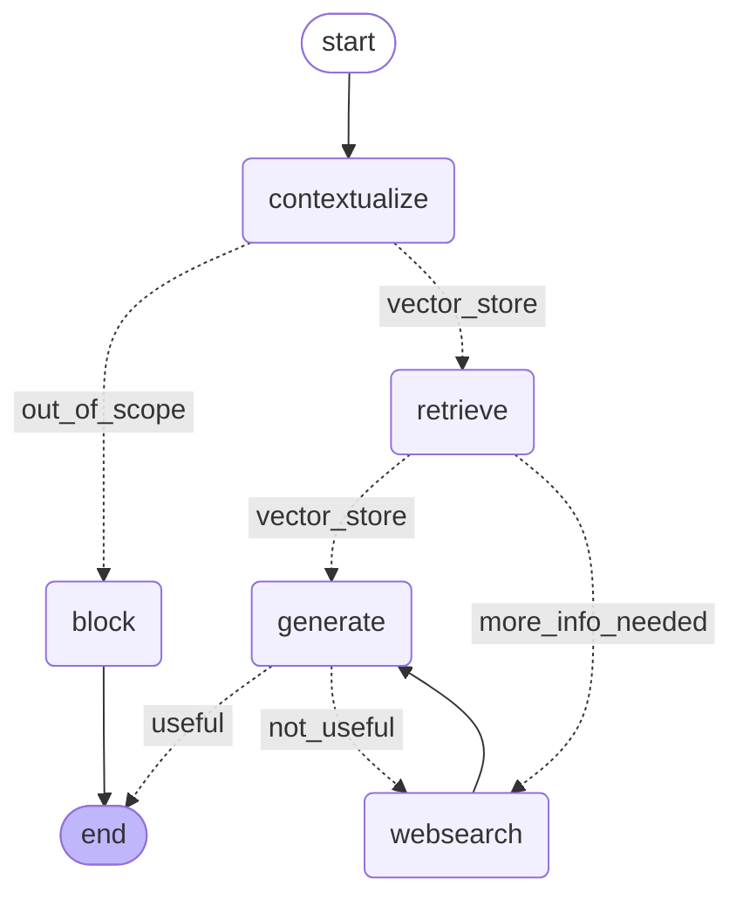

# DocuQuery RAG Agent

<div align="center">
  


</div>

<br/>

---

**DocuQuery RAG Agent** is an on-premise Retrieval-Augmented Generation (RAG) system designed to process and query technical documentation (like PDFs) with precision.

This project runs entirely locally using open-source LLMs.

## User Interface




## Architecture Stack

The system is fully containerized and divided into three main microservices:

* **Frontend (Next.js):** Reactive chat-based UI built with Next.js 16, TailwindCSS v4, and Framer Motion. Features dynamic state management via Zustand, real-time metrics, and document ingestion.
* **Backend API (FastAPI):** Handles routing, input/output validation via Pydantic, and file uploads.
* **AI Engine (LangChain & Ollama):** 
    * **LLM:** `phi4-mini (3.8B)` via Ollama for local reasoning, chosen with the eval suite (best accuracy that fits a 4 GB GPU).
    * **Vision LLM:** `Moondream (1.8B)` via Ollama for image captioning.
    * **Embeddings:** `nomic-embed-text` (with its `search_query:` / `search_document:` task prefixes) for semantic search.
    * **Vector DB:** `ChromaDB` for persistent local storage of chunked data.

## Agent Workflow



<sub>Generated from the compiled graph: `cd backend && python -c "from ai.agent import load_agent; print(load_agent().get_graph().draw_mermaid())"`</sub>

## Core Features (What's working right now)
The project has recently evolved from a linear pipeline into an Agentic application. Current capabilities include:

* **Stateful Agentic RAG:** Powered by LangGraph, replacing linear chains with a cyclical graph architecture capable of maintaining conversational state and memory.
* **Follow-up Question Rewriting:** Follow-ups like "what about its voltage?" are rewritten into standalone questions using the chat history before routing, retrieval, and web search, so they find the right documents.
* **Semantic Query Routing (Guardrails):** A structured-output router (JSON-schema constrained) blocks small talk and unrelated requests while sending anything that could be answered from the uploaded documents to retrieval. It sees the uploaded document names and prefers answering when in doubt.
* **Self-Reflective Loop (CRAG):** If even the best retrieved chunk scores below a calibrated relevance threshold, the agent falls back to web search. An optional grader (`ENABLE_ANSWER_GRADER`) checks the answer against the documents and can trigger a web search retry.
* **Web Search Fallback:** If the local document database does not contain the answer, the agent autonomously falls back to querying the web (via DuckDuckGo) to augment its context.
* **Multimodal Ingestion:** Handles multiple PDFs simultaneously. Extracts page text with `PyMuPDF` (column-aware, with umlaut/ligature cleanup), tabular data as Markdown (via `pdfplumber`), and parses diagrams/images into searchable text using a Vision LLM (`moondream` via `PyMuPDF`).
* **API Backend:** FastAPI handles document chunking, embedding, and chat routing with robust error handling and telemetry control.
* **Conversation Memory:** The last 6 messages are sent to the model as real chat turns (no summarization call), and follow-up questions are rewritten into standalone ones before routing and retrieval.
* **Token Streaming:** Token-by-token generation in the FastAPI backend and Next.js UI for a faster user experience.
* **Source Citations:** The agent's output is enhanced to explicitly cite the source document name, web link, or page number it used to generate the answer.

## Evaluation

`evals/` measures answer accuracy, retrieval, citations, web-search use, LLM calls and latency against a local Ollama, on a synthetic corpus and optionally on your own PDFs. See [evals/README.md](evals/README.md).

```bash
uv run python -m evals.run --compare evals/baselines/synthetic.json
```

## Quick Start

### Prerequisites
* **Docker & Docker Compose** installed.
* **NVIDIA Container Toolkit** installed (if using Linux/WSL) to enable GPU passthrough for the Ollama container.

1. **Clone the repository:**
    ```bash
    git clone https://github.com/matteoespo/docuquery-rag-agent.git
    cd docuquery-rag-agent
    ```

2. **Configure Environment Variables:**
    Copy the example environment file. LangSmith tracing is off by default; set `LANGSMITH_TRACING=true` and `LANGSMITH_API_KEY` only if you want traces and the Analytics page (this sends prompts and document chunks to LangSmith):
    ```bash
    cp .env.example .env
    ```

3. **Deploy the stack with Docker:**
    ```bash
    docker-compose up -d --build
    ```

4. **Pull the local models:**
    *Run inside the Ollama container:*
    ```bash
    docker exec -it docuquery-rag-ollama ollama pull phi4-mini
    docker exec -it docuquery-rag-ollama ollama pull moondream
    docker exec -it docuquery-rag-ollama ollama pull nomic-embed-text
    ```

## Access the Application

* **Web UI:** Navigate to http://localhost:3000 to upload a pdf and start chatting.
* **API Docs:** Navigate to http://localhost:8000/docs to test endpoints via Swagger UI.
